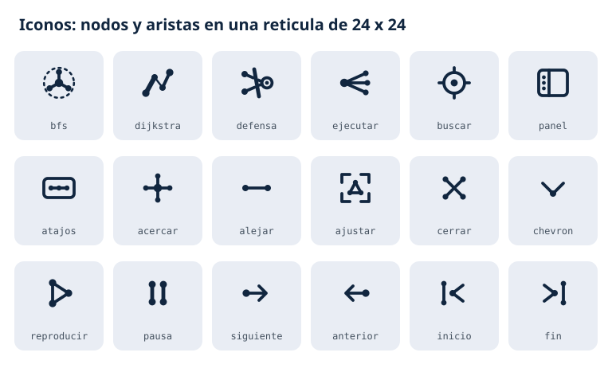

# Documento de diseño

Guía visual de la aplicación web (`python main.py servir`) y del visor offline
(`visor.html`). Las dos comparten la misma página, definida en
`grafo_ad/interfaz_web.py`, así que todo lo descrito aquí aplica a ambas.

## Principios

- **Diseño plano.** Superficies de color sólido, sin degradados ni sombras. La
  jerarquía sale del color, el tamaño y el espacio, no de efectos de relieve.
- **El color significa algo.** Cada tono se reserva para un concepto (objetivo,
  camino, corte, objeto aislado) y se usa igual en el grafo, la leyenda y el panel.
- **Todo se explica en pantalla.** Cada color de nodo, estilo de arista y tipo de
  acceso tiene su lectura en la leyenda o en la etiqueta flotante.
- **Movimiento con propósito.** Las animaciones muestran qué hace el algoritmo o
  hacia dónde va la atención; nunca son decorativas.

## Logo

El logo resume la idea de la herramienta: tres objetos del directorio (nodos
blancos) tienen accesos hacia un objetivo de alto valor (la diana roja), y el
corte mínimo (la barra ámbar) interrumpe esos accesos.

- **Retícula:** 48 x 48 con esquinas de radio 12.
- **Colores:** fondo azul `#2e5aac`, nodos y aristas blancos, corte ámbar
  `#ffd37a`, objetivo rojo `#c0392b` con anillo blanco.
- **Tamaño mínimo:** 16 px (favicon). En la barra lateral se usa a 44 px.
- **Uso:** siempre sobre su propio cuadro azul; no se recolorea, no se rota y no
  se separa el corte de las aristas.
- **Marca escrita:** el nombre "Analizador de rutas y defensa" va en Bebas Neue,
  a la derecha del logo, con el subtítulo en Bahnschrift.

Archivo: `diseno/logo.svg`. La definición fuente es la constante `LOGO` de
`grafo_ad/interfaz_web.py`, que también genera el favicon.

## Color

### Superficies y texto

| Token | Valor | Uso |
|-------|-------|-----|
| `--navy-900` | `#11263f` | Barra lateral, reproductor, etiquetas flotantes |
| `--navy-800` | `#17304f` | Paneles y tarjetas sobre la barra lateral |
| `--navy-700` | `#1c3350` | Campos de formulario, elementos activos |
| `--navy-600` | `#33496b` | Bordes y controles |
| `--navy-500` | `#3d567f` | Estado hover de controles |
| `--fondo` | `#e9edf4` | Lienzo del grafo |
| `--texto` | `#1b2430` | Texto sobre fondos claros |
| `--texto-claro` | `#e8edf5` | Texto sobre la barra lateral |
| `--texto-tenue` | `#9fb0c7` | Texto secundario sobre la barra lateral |
| `--ambar` | `#ffd37a` | Cifras y nombres destacados, tipos de acceso |
| `--enlace` | `#8fb4ee` | Enlaces y anillo de foco del teclado |

### Colores con significado

| Token | Valor | Nodos | Aristas y acciones |
|-------|-------|-------|--------------------|
| `--rojo` | `#c0392b` | Objetivo a proteger | Acceso a revocar (corte mínimo), errores |
| `--naranja` | `#e67e22` | Objetos de alto valor | Camino hallado, nodo que se expande |
| `--azul` | `#2e5aac` | Usuarios | Conexiones resaltadas, búsqueda, acción principal |
| `--turquesa` | `#16a085` | Equipos | - |
| `--morado` | `#8e44ad` | Grupos | Camino de aumento del flujo máximo |
| `--morado-claro` | `#b9a7d6` | - | Caminos de aumento ya encontrados |
| `--gris` | `#7f8c8d` | GPO, OU y dominio | - |
| `--verde` | `#1a7f43` | Objeto aislado tras el corte | Reproducir, plan de defensa |
| `--arista` | `#c2ccda` | - | Trazo base de todas las aristas |

## Tipografía

| Familia | Rol | Dónde |
|---------|-----|-------|
| **Bebas Neue** | Títulos y cifras | Nombre de la herramienta, encabezados de sección, títulos de tarjetas y del panel, métricas, guías de la vista radial |
| **Bahnschrift** | Texto | Cuerpo, botones, etiquetas del grafo, listas, avisos |
| Monoespaciada (`ui-monospace`, Consolas) | Datos técnicos | Tipos de acceso (`MEMBER_OF`, `ADMIN_TO`...), atajos de teclado |

Escala usada:

| Elemento | Familia | Tamaño |
|----------|---------|---------|
| Nombre de la herramienta | Bebas Neue | 25 px, espaciado .03em |
| Cifras de las métricas | Bebas Neue | 30 px |
| Títulos del panel de resultados | Bebas Neue | 18 px |
| Títulos de las tarjetas de algoritmo | Bebas Neue | 17 px |
| Encabezados de sección | Bebas Neue | 15 px, espaciado .08em |
| Texto base | Bahnschrift | 13 px, interlineado 1.5 |
| Texto secundario | Bahnschrift | 11 a 12.5 px |
| Etiquetas del grafo | Bahnschrift | 11 px (12.5 px el nodo enfocado) |

Bebas Neue solo tiene mayúsculas, por eso no se usa para nombres de objetos, que
deben conservar su forma original. Bahnschrift viene con Windows; si falta, la
página usa DIN Alternate, Segoe UI o la fuente del sistema.

**Bebas Neue va incrustada.** El archivo `grafo_ad/recursos/BebasNeue-Regular.ttf`
(Dharma Type, versión 2.000) se incrusta en la página en base64, de modo que los
títulos se ven igual sin internet y sin la fuente instalada. Se distribuye bajo la
SIL Open Font License 1.1, cuyo texto acompaña al archivo en
`grafo_ad/recursos/OFL-BebasNeue.txt`.

## Iconos

Los iconos son propios de la herramienta y comparten el lenguaje del grafo: cada
uno se dibuja con **nodos** (círculos llenos) unidos por **aristas** (trazos). En
lugar de los símbolos genéricos (lupa, escudo, triángulo de reproducir), cada
acción se expresa con una pequeña figura de grafo.

Reglas de construcción:

- Retícula de 24 x 24.
- Trazo de 1.9 con puntas y uniones redondeadas. Los trazos más gruesos o finos
  solo se usan cuando el grosor significa algo (los pesos en Dijkstra).
- Nodos de radio 1.2 a 2.6; el nodo principal de cada icono es el más grande.
- Un solo color, heredado del texto (`currentColor`), para que el icono funcione
  sobre fondos claros y oscuros.
- Se definen una vez como símbolos SVG y cada botón los referencia con `<use>`.

| Icono | Significado |
|-------|-------------|
| `bfs` | Ruta más corta (BFS): un nodo y su primer nivel de vecinos |
| `dijkstra` | Ruta de menor esfuerzo (Dijkstra): tramos de distinto peso |
| `defensa` | Plan de defensa: un corte interrumpe los accesos hacia el objetivo |
| `ejecutar` | Ejecutar: el origen lanza la exploración hacia sus vecinos |
| `buscar` | Buscar: mira que fija un nodo |
| `panel` | Mostrar u ocultar el panel: columna con los pasos |
| `atajos` | Atajos de teclado: tecla con una hilera de nodos |
| `acercar` | Acercar: estrella de cuatro aristas en forma de más |
| `alejar` | Alejar: una sola arista en forma de menos |
| `ajustar` | Ajustar a la vista: un grafo pequeño entre esquinas |
| `cerrar` | Cerrar o quitar: dos aristas cruzadas |
| `chevron` | Desplegar: dos aristas que se unen en un nodo |
| `reproducir` | Reproducir: triángulo de tres nodos |
| `pausa` | Pausa: dos aristas verticales |
| `siguiente` | Paso siguiente: un nodo que avanza por su arista |
| `anterior` | Paso anterior: el mismo recorrido en sentido inverso |
| `inicio` | Ir al inicio: retroceso hasta el primer nivel |
| `fin` | Ir al resultado: avance hasta el último nivel |

Archivo: `diseno/iconos.svg`. La definición fuente es el diccionario `ICONOS` de
`grafo_ad/interfaz_web.py`.

## Lenguaje visual del grafo

### Nodos

- **Color:** según su tipo (tabla de color). El objetivo siempre en rojo y los
  objetos de alto valor en naranja, por encima de su tipo.
- **Tamaño:** el objetivo mide 11, los de alto valor 7.5 y el resto crece con su
  número de conexiones, entre 4 y 8.
- **Anillos:** azul marino para el origen elegido; naranja para el nodo que se
  expande; azul para un vecino recién descubierto; rojo para el objetivo al final.
- **Frontera:** un círculo hueco (relleno blanco con borde de su color) marca un
  objeto descubierto que aún no se expande.
- **Insignias:** una pastilla azul marino con la distancia conocida desde el
  origen, en saltos (BFS) o en peso acumulado (Dijkstra).
- **Etiquetas:** siempre visibles para el objetivo, los de alto valor y el
  origen; las demás aparecen al acercar la vista o al enfocar un nodo vecino.

### Aristas

Una arista `A -> B` se lee siempre igual: quien controla A puede llegar a
controlar B.

| Estilo | Significado |
|--------|-------------|
| Gris fino, sin flecha | Acceso del grafo |
| Azul con flecha y partícula | Accesos del objeto enfocado, o explorados por la búsqueda |
| Naranja grueso con partícula | Camino hallado por BFS o Dijkstra |
| Morado | Camino de aumento del flujo máximo (morado claro: ya encontrados) |
| Rojo punteado en movimiento | Acceso a revocar (corte mínimo) |
| Azul marino grueso | Arista bajo el cursor |

La partícula viaja en el sentido del acceso para que la dirección del control se
lea sin necesidad de ampliar la flecha. Pasar el cursor sobre una arista muestra
su tipo de acceso y lo que permite; la pestaña "Accesos" de la leyenda lista los
tipos presentes con su conteo y los resalta en el grafo.

### Enfoque

- **Al pasar el cursor** sobre un nodo se resaltan sus vecinos y sus accesos de
  entrada y salida; el resto baja al 12 % de opacidad.
- **Al hacer clic** el enfoque queda fijado: sus conexiones siguen encendidas
  hasta hacer clic en un espacio vacío, pulsar Esc o cerrar su tarjeta.
- La leyenda resalta del mismo modo un tipo de objeto o un tipo de acceso.

### Disposiciones

- **Fuerzas:** simulación con resortes en cada arista y repulsión entre nodos; el
  objetivo queda fijo en el centro.
- **Radial:** cada objeto queda en el anillo de su distancia en saltos al
  objetivo. El radio de cada anillo crece con la cantidad de objetos que contiene
  (al menos 34 px de arco por objeto y 70 px entre anillos) y unas guías punteadas
  indican el número de saltos.

## Componentes

- **Barra lateral (340 px):** pasos numerados (objetivo, algoritmo, origen),
  botón Ejecutar y resultado. Se pliega con un margen negativo para que su
  contenido no se reacomode durante la animación.
- **Tarjetas de algoritmo:** icono en un cuadro de 34 px, título en Bebas Neue y
  descripción corta. La tarjeta activa toma el color de su algoritmo en el borde
  y en el icono.
- **Recuadro de origen:** borde punteado cuando está vacío y continuo cuando hay
  un origen; se sacude si se intenta ejecutar sin origen.
- **Control segmentado:** opciones excluyentes (objetos de entrada, disposición,
  pestañas de la leyenda y de la tarjeta de detalle).
- **Reproductor:** barra inferior azul marino con ir al inicio, anterior,
  reproducir o pausar, siguiente, ir al resultado, línea de tiempo y velocidades
  de 1x a 8x. Aparece al ejecutar y la reproducción arranca sola.
- **Línea de estado:** pastilla sobre el reproductor que describe el paso actual.
- **Leyenda:** tarjeta blanca con las pestañas "Objetos" y "Accesos".
- **Tarjeta de detalle:** tipo, distancia al objetivo, acciones y las listas de lo
  que el objeto controla y de quien lo controla.
- **Avisos:** mensajes breves con una franja de color a la izquierda (rojo para
  errores, azul para indicaciones) que desaparecen solos a los 3.8 s.

Las superficies sobre el lienzo son blancas con un borde de 1 px `#d5dce7` y
radio de 10 px; las de la barra lateral usan los tonos azul marino.

## Movimiento

- **Curva de aceleración:** `cubic-bezier(.2, .7, .2, 1)` para las transiciones de
  interfaz; entrada y salida cúbica para los vuelos de cámara.
- **Duraciones:** 150 ms en cambios de color y hover, 250 a 400 ms en paneles,
  pestañas y apariciones, 650 ms en los vuelos de cámara.
- **Algoritmos:** cada arista nueva crece desde su origen en 350 ms y cada nodo
  que cambia de estado aparece con un rebote de 420 ms. El camino final se
  ilumina tramo a tramo cada 120 ms; el corte aparece escalonado cada 40 ms y los
  objetos aislados se vuelven verdes en una ola que avanza 140 ms por salto desde
  el objetivo.
- **Pulsos:** el nodo activo emite dos ondas desfasadas, como un sonar.
- **Movimiento reducido:** con la preferencia del sistema activada, la
  disposición se calcula de una vez y se omiten partículas, pulsos y transiciones.

## Interacción

| Acción | Resultado |
|--------|-----------|
| Pasar el cursor sobre un nodo | Resalta sus conexiones y muestra su resumen |
| Clic en un nodo | Lo fija como foco, abre su tarjeta y, en BFS o Dijkstra, lo elige como origen |
| Pasar el cursor sobre una arista | Muestra su tipo de acceso y lo que permite |
| Arrastrar un nodo | Lo mueve; la simulación acomoda a sus vecinos |
| Doble clic en un nodo | Acerca la cámara hacia él |
| Rueda del ratón | Acerca o aleja en torno al cursor |

Atajos: `/` buscar, `Espacio` reproducir o pausar, flechas paso anterior o
siguiente, `Inicio` y `Fin`, `E` ejecutar, `F` ajustar la vista, `+` y `-`
acercar o alejar, `R` cambiar la disposición, `P` mostrar u ocultar el panel,
`Esc` cerrar y quitar resaltados.

## Accesibilidad

- Todo control tiene una etiqueta accesible (`aria-label` o texto visible) y los
  grupos de opciones usan roles de radio o pestaña.
- El foco del teclado se marca con un contorno de 2 px en `--enlace`.
- El texto claro sobre azul marino y el texto oscuro sobre el lienzo mantienen un
  contraste alto; el color nunca es el único portador de significado, porque cada
  estado tiene también forma (anillo, hueco, guion, insignia) y texto en la
  leyenda.

## Archivos

| Archivo | Contenido |
|---------|-----------|
| `grafo_ad/interfaz_web.py` | Página completa: estilos, iconos (`ICONOS`), logo (`LOGO`) y comportamiento |
| `grafo_ad/recursos/BebasNeue-Regular.ttf` | Fuente de títulos que se incrusta en la página |
| `grafo_ad/recursos/OFL-BebasNeue.txt` | Licencia de la fuente |
| `diseno/logo.svg` | Logo en SVG |
| `diseno/iconos.svg` | Hoja con todos los iconos |
